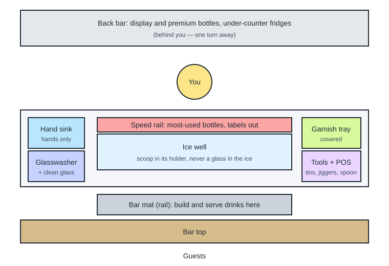

# 01.2 · The bar station and your home practice station

A bar station is the small area one bartender works from: ice, the most-used bottles, tools, glasses and a sink, all within reach. Good bartenders are fast mostly because their station is laid out well, not because their hands are faster. This lesson walks through a professional station part by part, shows why each thing sits where it does, and then helps you build a cheap home version that trains the same habits.

## Why it matters

It is 23:00 and four orders arrive at once. A bartender with a well-set station reaches for the gin without looking, because it is always the third bottle from the left on the speed rail. A bartender with a messy station turns around, searches the back bar, walks to the other end for a jigger and comes back. Each search costs five to ten seconds. Over a night of 200 drinks that is more than half an hour of wasted movement, and the guests feel every second.

## Core ideas

### The parts of a station

| Part | Hebrew you may hear | What it is | Why it is where it is |
|---|---|---|---|
| Bar top | בר (*bar*) | The counter guests sit or stand at | Guests order and receive drinks here |
| Bar mat (rail) | "the rail" / מגש ניקוז (*magash nikuz*, drip tray) | A ribbed rubber mat or metal drip tray on your side of the bar top | You build drinks here, in front of the guest, and spills drain away |
| Ice well | מיכל קרח (*mekhal kerach*) | An insulated bin of ice built into the counter in front of you | Ice is used in almost every drink, so it sits at the centre |
| Speed rail | "speed rail" (English is used) | A metal shelf on the front of the ice well holding the most-used bottles | The bottles you pour most are at knee to waist height, one reach away |
| Back bar | בק בר (*bek bar*) | Shelves and fridges behind you | Display bottles, premium spirits, wine and beer; one turn away |
| Hand sink | כיור ידיים (*kiyor yadayim*) | A sink used only for washing hands | Hygiene rules keep hand washing separate from glass and food |
| Glasswasher | מדיח (*mediach*) | A small commercial dishwasher for glasses | Clean glass close to where it is used |
| Garnish tray | — | A covered tray with cut citrus and other garnish | Next to where you finish drinks |
| POS | קופה (*kupa*) | The till or touchscreen where orders are entered and paid | Usually at the end of the station or shared |

The well (sometimes "the well station") means the ice well together with the speed rail. "Well spirits" or "house pours" are the standard spirits a bar uses when a guest does not name a brand.

> [!NOTE]
> Hebrew station words above are common usage in Israeli bars as of 2026-10-17 and are professional judgment, not official terms. Many bars simply use the English words.

### Three rules of a good station

1. **Reach.** The things you use most often (ice, scoop, house spirits, jigger, shaker tins, bar spoon) are within one arm's reach without stepping. Less-used items can be one step or one turn away.
2. **Same place, every shift.** Each item has a fixed home. You return it after every use. This lets you grab without looking, and lets a colleague cover your station.
3. **Clean and separate.** Ice is food. The ice scoop lives in a holder or with its handle out of the ice; a glass never goes into the ice (lesson 01.6 explains why). Hand washing has its own sink. Raw food and cleaning chemicals stay away from ice and garnish. Food-safety codes such as the U.S. FDA Food Code (a model code many authorities adopt) set rules like these; Israeli requirements are covered in Module 9.

### How a station is used

The bartender moves in short, repeated loops: glass from the rack → ice from the well → spirit from the speed rail → modifiers (juice, syrup) from the tool area → finish on the bar mat → serve → reset. A good layout makes that loop short and the same every time. Left-handed bartenders often mirror the layout; that is fine as long as it is consistent.

### A home station that trains the same habits

You do not need a bar at home. You need a stable surface about 60–80 cm wide, a towel, and the core tools in fixed positions. The table gives rough prices in Israeli shekels. They are professional judgment for basic, not premium, tools as of 2026-10-17 and were not checked at a particular shop; check current prices before buying.

| Item | Rough price (₪) | Free or kitchen alternative |
|---|---|---|
| Two-piece shaker tins (Boston: large + small tin) | 40–80 | A jar with a tight lid (for example a 500 ml jam jar) |
| Jigger, 30/60 ml or 30/45 ml, with inner lines | 20–50 | Medicine cup, measuring spoons (15 ml = 1 tbsp) |
| Bar spoon, about 30 cm | 15–40 | Long teaspoon or chopstick for stirring practice |
| Hawthorne strainer | 20–50 | A slotted spoon held against the jar mouth |
| Fine strainer | 10–30 | Tea strainer |
| Y-peeler and small paring knife | 30–80 | The ones already in your kitchen |
| Cutting board (non-slip) | 20–50 | Any board on a damp cloth |
| Hand citrus press | 25–60 | Fork or reamer |
| Silicone ice trays (two) | 15–40 | Ordinary ice trays |
| Kitchen scale, 1 g steps | 40–80 | Measuring jug read at eye level |
| **Total** | **≈ 235–560** | **almost ₪0** |

Most learners already own a knife, board and ice trays, so a basic set usually ends up around ₪250–400. Buy the jigger and the scale first: they give you numbers. A shaker and strainer come next. Glassware is covered in lesson 01.5; use what you have.

## Step by step

### Lay out your home station

1. Clear a counter or table space about 60–80 cm wide. Put a folded towel or a rubber mat in the middle front: this is your bar mat.
2. Put a bowl or ice bucket in the centre back: your ice well. Put the ice scoop (or a large spoon) in a cup next to it, not in the ice.
3. In front of the bowl, line up three to five bottles of water, tea or juice as your speed rail. Labels face you; the most-used one goes nearest your strong hand.
4. On your strong-hand side, place the tool area: tins, jigger, bar spoon, strainers, in that order from nearest to farthest.
5. On the other side, place the cutting board on a damp cloth, with the peeler and knife at the top edge of the board, blades pointing away from you.
6. Keep a dry towel for glasses and a damp towel for the surface at the edge of the mat.
7. Put a small bin or bag and a container for empties within one step.
8. Stand in front of the mat. Without moving your feet, can you reach the ice, every bottle and every tool? If not, move things closer.

### Check the station with a "blind reach" test

1. Stand at the mat and close your eyes.
2. Say an item ("jigger", "bottle three", "scoop") and reach for it.
3. Open your eyes. Did your hand land on it? Repeat for every item.
4. Anything you missed is either too far or not in a fixed place. Move it and test again.

## Hands-on

> [!CAUTION]
> Keep the knife at the top of the board with the blade facing away from you, and never leave it under a towel or in a sink of water where you cannot see it.

### What you need

- The items in the home-station table above, or their kitchen alternatives.
- A tray of ice, a towel, three to five bottles of water or juice.
- Paper and pen, and a phone camera.
- The shopping and setup sheet: [labs/module-01/home-station-list.md](../../labs/module-01/home-station-list.md).
- Low-cost alternative: everything in the "Free or kitchen alternative" column. The habits you train (fixed places, reach, cleanliness) are the same.

### Time

60 minutes: 15 to gather items, 20 to lay out, 15 to test and adjust, 10 to draw and photograph.

### Steps

1. Tick on the setup sheet which items you have, which you will buy and which you will replace with a kitchen alternative.
2. Lay out the station following the steps above.
3. Run the blind reach test for every item. Move items until you hit every one with eyes closed.
4. Draw a simple top-down map of your station (boxes and labels, like the diagram in this lesson). Mark your standing position.
5. Take a photo from above and one from where a guest would stand.
6. Time yourself putting everything away and setting it out again from the map. Write the setup time in your practice log ([template](../../templates/practice-log.md)). You will beat it in lesson 01.7.

### What you should see

A station about 60–80 cm wide, where you can reach everything without stepping, with the ice and the scoop in the middle, bottles in front of the ice, tools on your strong-hand side and the board on the other. Your first setup usually takes 8–15 minutes because you are still deciding where things go (professional judgment). The second setup from your map should be clearly faster. If it is not, your map is not specific enough: add positions ("jigger: right of the tins, cup facing up").

### What this practice cannot teach

A real bar is wet, crowded and shared with other bartenders and barbacks walking behind you, and every bar's layout is a little different; you will have to learn each new station on your first shift.

### Completion checklist

- [ ] I can name each part of a professional station and say why it is placed there.
- [ ] My home station is set up with fixed positions for every item.
- [ ] I passed the blind reach test for every item.
- [ ] I drew a station map and took two photos.
- [ ] My first setup time is in my practice log.

## Common mistakes

- **Tools wherever they land.** If the jigger is in a different place each time, you look for it each time. Fix: give every tool a home and return it after every use.
- **The scoop left in the ice.** The handle touches hands, then the ice. Fix: keep the scoop in its holder or a clean cup next to the ice.
- **Bottles with labels turned away.** You grab the wrong one. Fix: labels face you on the rail; in a bar they face the guest on the back bar.
- **Station too wide.** Spreading out "to have space" adds steps. Fix: compact first; everything within one reach.
- **Buying expensive kit first.** A ₪300 shaker does not make better drinks than a ₪50 one. Fix: buy the jigger and a scale first, then the basics; upgrade later.
- **Washing hands in the bar sink or the ice well.** Fix: one sink for hands only, at home use the kitchen sink before you start, not the bowl you keep ice in.

## Key takeaways

- A station is everything one bartender needs within reach: ice, speed rail, tools, glass, sink, garnish and POS.
- Speed comes from reach and fixed positions, not from fast hands.
- Ice is food: the scoop lives outside the ice and nothing else goes in.
- A home station of tins, jigger, spoon, strainers, peeler, knife, board, press, ice trays and a scale costs roughly ₪250–400, or close to nothing from your kitchen.
- Map your station and keep the map: you use it for the timed drill in lesson 01.7.

## Sources

- [U.S. FDA — Food Code 2026](https://www.fda.gov/food/fda-food-code/food-code-2026) (model food-safety code; storage of in-use utensils such as ice scoops; accessed 2026-10-17)
- [Difford's Guide — Ice: clear, cubed and crushed](https://www.diffordsguide.com/encyclopedia/3138/cocktails/ice-clear-cubed-and-crushed) (ice handling at the station; accessed 2026-10-17)
- [U.S. Bureau of Labor Statistics — Occupational Outlook Handbook: Bartenders](https://www.bls.gov/ooh/food-preparation-and-serving/bartenders.htm) (cleaning and restocking duties; accessed 2026-10-17)
- Prices: professional judgment, not checked at a named shop (2026-10-17).
