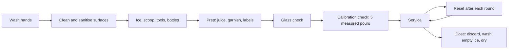

# 01.7 · Hygiene, setup and reset: the timed station drill

A bar is a food business: drinks, ice and garnish go into people's mouths. Hygiene is not an extra task done at closing; it is built into how you set up, how you work and how you reset after every round. This lesson covers personal hygiene, the difference between cleaning and sanitising, labelling prep, and the fixed order of setup, reset and close. It ends with the module's practical piece: a timed station drill that uses everything from Module 1, scored against a checklist with target times.

## Why it matters

Opening time is 19:00 and you arrive at 18:30. In half an hour the station must be clean, stocked, iced, garnished and checked, with juices labelled and every tool in its place. If setup takes you 45 minutes, the bar opens late or you start the night behind. If you skip steps to be fast, a guest gets a drink in a dirty glass or a lime wedge cut on yesterday's board. Bar managers judge new staff on exactly this: a clean station set up fast, in the same order every time, and kept that way through the night.

## Core ideas

### Words you will hear

| English | Hebrew (transliteration) |
|---|---|
| Cleaning | ניקיון (*nikayon*) |
| Sanitising / disinfecting | חיטוי (*chitui*) |
| Cloth (for wiping) | סמרטוט (*smartut*) |
| Towel (for glass) | מגבת (*magevet*) |
| Opening / closing | פתיחה / סגירה (*ptiha / sgira*) |
| Date | תאריך (*ta'arich*) |

Usage is professional judgment as of 2026-10-17.

### Personal hygiene

**Hands.** The CDC's five steps: wet with clean running water, apply soap, lather everywhere (backs, between fingers, under nails), scrub for at least 20 seconds, rinse, and dry with a clean towel or air dryer. Wash in the hand sink:

- when you start the shift and after every break;
- after the toilet, eating, smoking or vaping;
- after touching your face, hair or phone;
- after taking out rubbish, handling empties or cleaning chemicals;
- before cutting garnish or handling ice and food;
- whenever you switch from a dirty task to a clean one.

**Appearance.** Hair tied back, clean short nails, clean clothes and apron. Keep jewellery on hands and wrists to a minimum: it traps dirt and can catch.

**Cuts.** Cover any cut on your hands with a waterproof plaster and a glove. If you cut yourself during prep, stop and throw away anything that may have blood on it (lesson 01.4).

**Illness.** If you have vomiting, diarrhoea, fever with a sore throat or similar symptoms, tell your manager before the shift. Food-safety codes exclude sick staff from handling food and drink; the FDA's 2026 Food Code, released in September 2026, now asks food businesses to keep a written employee-illness policy. Israeli Ministry of Health requirements are covered in Module 9.

### Cleaning versus sanitising

- **Cleaning** removes visible dirt, sugar and grease, with detergent and water. A surface must be clean before it can be sanitised.
- **Sanitising** reduces germs on a clean surface to a safe level, using an approved sanitiser at the concentration and contact time on its label (or very hot water in a glasswasher).

The order is always: **clean → rinse → sanitise → air-dry**. Wiping a sticky bar with sanitiser does not sanitise it; the sugar protects the germs.

> [!WARNING]
> Never mix cleaning chemicals. Bleach mixed with acid descalers or ammonia-based cleaners releases toxic gas. Use each product as its label says, store chemicals labelled, below and away from ice, glass and garnish, and never in drink bottles.

### Two towels, two jobs

Keep a **dry towel** only for glass and your hands' last wipe, and a **damp cloth** for wiping surfaces. Food codes require wiping cloths in use to be kept in sanitiser solution between uses, or dry and used only for spills. Never polish a glass with the cloth that just wiped the bar.

### Label and date everything you prep

Every bottle of juice or syrup and every container of garnish gets a label: **what it is, and the date (and time for juice) it was made**. Use the oldest first: FIFO, "first in, first out". Shelf life of juices and syrups is covered in Module 3; storage rules in Module 8. If you find something unlabelled, it goes in the bin.

### Setup, service, reset, close

- **Setup** (opening): everything clean, stocked and in its fixed place before the first guest.
- **Reset**: after each round of drinks, return every tool, rinse tins and jiggers, wipe the mat, cap bottles. A station that is reset constantly never becomes a mess.
- **Close**: throw away or store perishables, wash and sanitise tools, empty and dry the ice well, clean surfaces, check the floor for glass.

The [station checklist](../../templates/station-checklist.md) lists every item for each phase. You use it in the drill.

## Step by step

### Setup (target ≤ 6:00 at home)

1. Wash your hands. Tie back hair, put on an apron or tuck a towel in.
2. Clean the work surface with detergent, rinse, then sanitise and let it air-dry. Put the cutting board on a damp cloth.
3. Fill the ice bowl or well. Put the scoop in its holder, not in the ice.
4. Set out tools in their fixed order (tins, jiggers, bar spoon, strainers, muddler, peeler, knife), as on your station map from lesson 01.2.
5. Line up bottles on your speed rail, labels facing you, most-used nearest your hand.
6. Prep: juice two limes into a labelled bottle (name, date, time), cut wheels or wedges into a covered container (lesson 01.4).
7. Check glasses: rim and sides against the light; set aside any chipped one (lesson 01.5).
8. Place a dry towel and a damp cloth, the bin and a container for empties.
9. Calibration check: measure five 30 ml pours of water with the jigger on the scale. At least 4 of 5 in tolerance (29–31 g).
10. Stop the clock. Write the time.

### Reset after a round (target ≤ 1:30)

1. Rinse tins, jigger, spoon and strainer; shake dry; return each to its place.
2. Cap bottles and return them to their spots on the rail.
3. Wipe the bar mat and surface with the damp cloth; dry with a clean part.
4. Clear used glasses to the wash area.
5. Check the ice and scoop: scoop in holder, ice level enough.

### Close (target ≤ 10:00)

1. Discard cut garnish and juice you will not keep; cover, label and refrigerate what you keep.
2. Empty the ice well into the sink; rinse and dry it.
3. Wash tools in hot soapy water, rinse, sanitise and air-dry. Knife washed alone and put away at once.
4. Clean, rinse and sanitise the surface and board.
5. Wipe and return bottles; bin out.
6. Check the floor for glass, ice and spills.
7. Wash your hands.

## Hands-on

This is the module's practical piece. It uses everything from Module 1: the station (01.2), measuring (01.3), knife and prep (01.4), glass (01.5), ice (01.6) and hygiene (this lesson).

> [!CAUTION]
> The drill uses a knife, glass and wet floors. Speed never overrides safety: a safety failure ends the run, whatever the time.

### What you need

- Your home station and every item from lesson 01.2.
- 2–3 limes or lemons, ice, water, 3 glasses, detergent and a household sanitiser used as its label says (or very hot soapy water if you have none).
- The [station checklist](../../templates/station-checklist.md) and the scoresheet: [labs/module-01/station-drill-scoresheet.md](../../labs/module-01/station-drill-scoresheet.md).
- Phone stopwatch, and phone camera on a stand or leaning on something (to film yourself).
- Your practice log ([template](../../templates/practice-log.md)).
- Low-cost alternative: every item has a kitchen stand-in; a bowl for the ice well, a jar for the shaker, measuring spoons for a jigger.

### Time

90 minutes for three full runs: about 30 minutes per run (setup, three resets after a "round" of three water drinks, close, scoring). You can split runs over two days.

### Steps

1. Start with everything put away: tools in a drawer, bottles in a cupboard, fruit whole, ice in the freezer.
2. Start filming and the stopwatch. Do the setup steps above, ticking the checklist as you go. Stop the clock at the end of step 10.
3. "Service round": make three water "drinks": one built over ice in a tall glass (60 ml), one shaken and strained into a glass (90 ml), one stirred and strained (90 ml). Measure every pour.
4. Reset, timed. Do three rounds and three resets, and write each reset time.
5. Close, timed.
6. Watch the video and fill the scoresheet: times, checklist items missed, calibration pours, safety items.
7. Log the run. Write the one thing that cost you most time.
8. Repeat for runs 2 and 3, fixing that one thing each time.

### What you should see

The first run usually misses the targets: 8–12 minutes for setup is normal (professional judgment). Most of that is searching and walking, which the video shows clearly. By the third run, with the station map and fixed positions, most learners reach the setup target or come within a minute of it. Resets should become automatic, under 90 seconds. A safety failure (glass used to scoop, scoop left in the ice, knife on the counter edge or in water, board not on a cloth) is not a time problem: it fails the run.

How to read your scoresheet

Pass for this module: all three phases within target on at least one run, all safety items "yes", no more than two checklist items missed, and 4 of 5 calibration pours in tolerance. If time is the problem, look at the video for walks and searches and move those items closer or fix their place. If missed items are the problem, read the checklist aloud as you go. If calibration fails, repeat the lesson 01.3 drill before the next run.

### What this practice cannot teach

A real opening involves stock deliveries, a glasswasher, an ice machine, a POS, colleagues setting up beside you and a manager checking your station, and real closing happens at 03:00 when you are tired; your home times are a baseline, not a promise.

### Completion checklist

- [ ] I can list when to wash my hands during a shift and wash them in the five steps.
- [ ] I can explain cleaning versus sanitising and the order clean → rinse → sanitise → air-dry.
- [ ] I completed three timed runs of setup, three resets and close, filmed and scored.
- [ ] At least one run met all three time targets with all safety items "yes".
- [ ] Every prep item I made was labelled with name and date.
- [ ] All three runs are in my practice log.

## Common mistakes

- **Sanitising a dirty surface.** Sugar and grease protect germs. Fix: clean and rinse first, then sanitise.
- **One towel for everything.** Fix: a dry towel for glass, a damp cloth for surfaces, and change them when dirty.
- **Unlabelled prep.** Nobody knows when the juice was made. Fix: label and date every container at the moment you fill it.
- **Racing the clock and skipping safety.** Fix: safety failures end the run; a slow safe run beats a fast unsafe one.
- **Resetting only "when there is time".** In a rush there never is. Fix: reset after every round, even a quick one.
- **Washing hands in the bar sink or not at all after the bin.** Fix: hand sink, every time you go from dirty to clean.

## Key takeaways

- Wash hands in five steps for at least 20 seconds, at the start and every time you move from a dirty to a clean task.
- Clean, rinse, sanitise, air-dry: in that order. Never mix chemicals; keep them away from ice and glass.
- Label and date every prep item and use the oldest first (FIFO).
- Setup, reset and close in a fixed order, with the station checklist, until it is automatic.
- Targets at home: setup ≤ 6:00, reset ≤ 1:30, close ≤ 10:00, with no safety failures.

## Sources

- [CDC — About handwashing](https://www.cdc.gov/clean-hands/about/index.html) (five steps, scrub at least 20 seconds; accessed 2026-10-17)
- [U.S. FDA — Food Code 2026](https://www.fda.gov/food/fda-food-code/food-code-2026) (model food-safety code: hand washing, wiping cloths, cleaning and sanitising, chemical storage; accessed 2026-10-17)
- [U.S. FDA — FDA releases 2026 Food Code](https://www.fda.gov/food/hfp-constituent-updates/fda-releases-2026-food-code) (released September 2026; written employee-illness policy; accessed 2026-10-17)
- [UK Health and Safety Executive — Safe use of knives in the kitchen](https://www.hse.gov.uk/catering/knives.htm) (knife storage and handling during cleaning; accessed 2026-10-17)
- [Difford's Guide — Ice: clear, cubed and crushed](https://www.diffordsguide.com/encyclopedia/3138/cocktails/ice-clear-cubed-and-crushed) (ice handling and glass breakage; accessed 2026-10-17)
- Target times: professional judgment for a home station, consistent with the practice-log template example.
