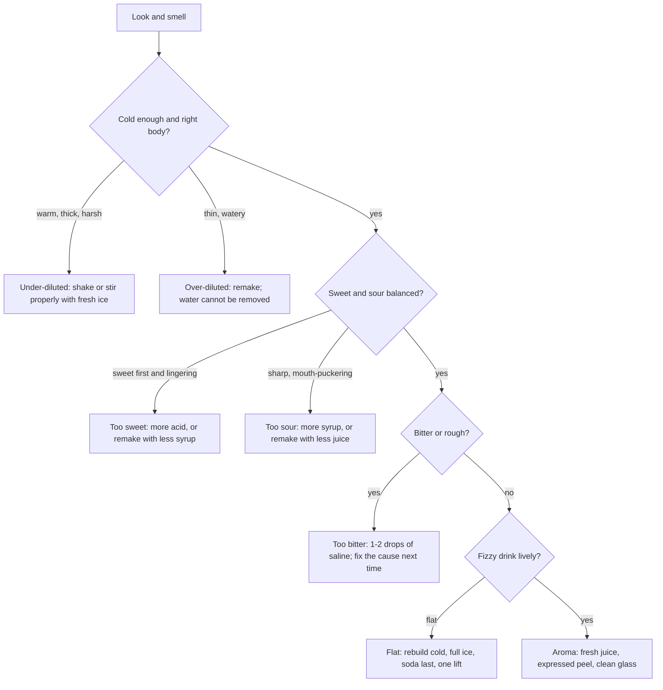

# 03.7 · Diagnose and fix unbalanced drinks

This is the practical piece of Module 3. Everything so far, units and measuring, taste and balance, syrups and juice, dilution and carbonation, comes together in one skill: tasting a drink that is wrong, naming exactly what is wrong, and fixing it with one deliberate change. In this lesson you learn a fixed tasting order and a short list of faults and fixes, then a partner makes you six deliberately broken non-alcoholic drinks, served blind, and you diagnose and fix each one, recording your evidence on the dilution worksheet.

## Why it matters

A colleague hands you a sour and says, "Something is off, can you taste it?" You have about ten seconds before the guest looks over. "Off" is not a diagnosis. "Under-shaken: warm, thick and too sweet" is, and it tells you exactly what to do: shake it properly with fresh ice. Bartenders who can name faults fix them quickly, explain them to colleagues without blame, and catch them before the guest does. The same skill lets you adjust a spec when the lemons change, and it is tested again in the final assessment.

## Core ideas

### One fault at a time, in a fixed order

Faults hide each other: a warm drink tastes sweeter, a watery drink tastes less sour and less sweet at once. So taste in an order where each check removes a cause before the next one ([lesson 03.3](lesson-03.md)):

### The six faults and their signatures

| Fault | What you notice | Usual causes | Fix |
|---|---|---|---|
| Too sweet | sweetness first and lingering, cloying finish | too much syrup, 2:1 used as 1:1, weak juice | remake with correct syrup; quick rescue: 5 ml more acid, taste |
| Too sour | sharp, puckering, thin sweetness | too much juice, very sour fruit, syrup under-poured | remake; quick rescue: 5 ml more syrup, taste |
| Under-diluted | warm, thick, sweet and sharp at once, harsh | short shake or stir, too little ice | shake 12–15 s or stir longer with fresh ice |
| Over-diluted | thin, watery, flat flavours, often pale | wet or crushed ice, drink left on ice, extra water | remake: water cannot be taken out |
| Flat (fizzy drinks) | few bubbles, dull and sweet | warm mixer, stirring, crushed ice, old open bottle | rebuild: cold soda, full ice, gentle pour, one lift |
| Too bitter or rough | bitter, drying grip on the tongue | over-brewed tea, pith in the juice, too much bitters | 1–2 drops of saline to soften now; fix the ingredient next time |

### Rescue or remake?

A **rescue** is a small addition to the drink you already have; a **remake** starts again. Rescue only when the fix is an addition (more acid, more syrup, a drop of saline, more chilling) and the drink is not yet over-full or over-diluted. Remake when the fix would be a removal (less water, less syrup) or when a rescue would change the size or spec. Every rescue changes the volume, so it is a tool for practice and for adjusting a spec, not a habit for serving guests (professional judgment). Behind a real bar, when in doubt, remake.

### Evidence, not opinion

Write down what you taste and what you measure. A dilution % from your scale (lesson 03.5) proves "under-diluted" or "over-diluted"; a fizz rating at 0 and 5 minutes proves "flat". The [dilution worksheet](../../templates/dilution-worksheet.md) has a balance-diagnosis table for exactly this.

> [!NOTE]
> The fault list and fixes are standard bar practice (professional judgment) built on the measured effects in lessons 03.3–03.6. They do not go out of date. Checked 2026-10-17.

## Step by step

### Diagnose one drink

1. Smell it. Note anything missing or wrong.
2. Take a small sip with a straw. Temperature and body first: warm and thick, or thin and watery?
3. If it is a fizzy drink, judge the bubbles.
4. Sweet against sour: which arrives first, which lingers?
5. Bitterness or a drying grip?
6. Name **one** main fault in the words from the table.
7. Decide: rescue or remake? Write the one change.
8. Make the change, taste again, and rate the result against the reference.

### Prepare the blind test (for your partner)

1. Your partner reads the fault cards in [labs/module-03/unbalanced-drinks.md](../../labs/module-03/unbalanced-drinks.md) without showing you.
2. They shuffle the six cards, number the glasses 1–6 on the bottom, and make each drink exactly as its card says.
3. They serve them to you one at a time and record which card went with which number.
4. They do not tell you anything until you have written all six diagnoses.

## Hands-on

### What you need

- A partner (or see the solo option below).
- Lemons, 1:1 syrup, black tea bags, soda water (one cold, one at room temperature), still water, saline (20%, from lesson 03.3), plenty of ice cubes and some crushed ice.
- Shaker, strainer, jigger, bar spoon, 8 glasses, straws, a kitchen scale, a phone timer, a thermometer if you have one.
- The fault cards and scoring sheet: [labs/module-03/unbalanced-drinks.md](../../labs/module-03/unbalanced-drinks.md). Answer key for your partner: [labs/module-03/unbalanced-drinks-solution.md](../../labs/module-03/unbalanced-drinks-solution.md).
- The [dilution worksheet](../../templates/dilution-worksheet.md), with six rows in the balance-diagnosis table, and your [practice log](../../templates/practice-log.md).
- Low-cost alternative: jars for shaking, any glasses, a tablespoon for 15 ml measures.

> [!CAUTION]
> Cut citrus on a stable board ([lesson 01.4](../module-01/lesson-04.md)) and keep the floor dry around the ice. Everything here is non-alcoholic.

### Time

90 minutes: 15 to make the two reference drinks and set up, 50 for six diagnoses and fixes, 15 to score, 10 to clean and log.

### Steps

1. **Make the references yourself.** Practice sour: 60 ml cold black tea (brewed 4 minutes), 22.5 ml lemon, 22.5 ml 1:1 syrup (or your balance point from lesson 03.3), shaken 15 s with 150 g ice, strained. Practice highball: full glass of ice, 22.5 ml lemon, 15 ml syrup, 150 ml cold soda, one lift. Taste both and rate them 5/5: this is your target.
2. Weigh the sour mix before ice and the drink after straining, so you know your normal dilution.
3. Your partner makes the six fault drinks blind, as described above. For each sour-based drink they also tell you the weight of the mix before ice.
4. For each glass: diagnose with the tasting order, weigh it, write the fault, the evidence and your one change on the worksheet.
5. Make the fix (rescue or remake, your choice, but justify it) and rate the fixed drink against the reference from 1 to 5.
6. When all six are written down, your partner reveals the cards. Score yourself with the sheet.
7. Optional: check your dilution evidence for the under- and over-diluted glasses against the model.
8. Log the session: score, the fault you found hardest, and what you will practise next.

[Simulation: Dilution lab — shaking](../../simulations/dilution-lab/index.html?preset=shake)

**Solo option:** make all six yourself from the cards on one day, write the label under each glass, have someone at home shuffle them, and taste blind. It is less blind, but the tasting order and the fixes are the same.

### What you should see

The sweet and sour faults are usually the easiest to name. Under- and over-diluted drinks are often confused with sweet and sour faults at first: a warm, under-shaken sour tastes too sweet and too sharp at once, and a watery one tastes "weak" rather than wrong; your scale settles it. The flat highball is obvious once you compare it with the reference. The bitter tea drink softens noticeably with two drops of saline but does not become as good as the reference, because the real fix is the tea. A good first result is 5 of 6 faults named correctly and 5 of 6 fixed drinks rated 4 or 5.

Reference result

Glass 1 (card D, over-diluted): thin, pale, everything weak; mix 111 g → drink 168 g, 51% dilution against a normal 26%. Remake. Fixed: 5/5.
Glass 2 (card A, too sweet): sweet first, cloying; added 5 ml lemon, still slightly sweet; remade with 22.5 ml syrup. Fixed: 5/5.
Glass 3 (card E, flat): few bubbles at 0 min, none at 5; rebuilt correctly. 5/5.
Glass 4 (card C, under-diluted): warm (about 12 °C), thick, sweet and sharp; mix 111 g → 117 g, 5% dilution. Shook again 15 s with fresh ice. 4/5.
Glass 5 (card F, bitter): drying, bitter finish; 2 drops saline: rounder, 3/5; remade with 4-minute tea: 5/5.
Glass 6 (card B, too sour): puckering; added 5 ml syrup: 4/5.
Score: 6/6 named, 6/6 fixed at 4 or 5 (glass 5 counted after the remake).

### What this practice cannot teach

Real cocktails add alcohol heat and body, and the faults that come from spirits (a corked or oxidised wine, a wrong spirit grabbed from the rail) need real products and tasting; Modules 4–6 and the final assessment come back to diagnosis with real specs.

### Completion checklist

- [ ] I made and rated both reference drinks and measured my normal dilution.
- [ ] I diagnosed six blind drinks using the tasting order and wrote the evidence for each.
- [ ] I chose rescue or remake for each and can say why.
- [ ] At least 5 of 6 faults were named correctly and 5 of 6 fixed drinks scored 4 or 5, or I logged which faults to practise and will repeat.
- [ ] My dilution worksheet and practice log are complete.

## Common mistakes

- **Fixing sweetness when the problem is temperature.** A warm drink tastes sweeter. Fix: check cold and dilution first.
- **Adding water to rescue an over-sweet drink.** It just makes a bigger, weaker, still-unbalanced drink. Fix: adjust the sweet-sour balance or remake.
- **Trying to rescue an over-diluted drink.** Water cannot be removed. Fix: remake.
- **Changing two things at once.** You learn nothing from the result. Fix: one change, taste, then the next.
- **Saline for everything.** It softens bitterness; it does not fix sweet, sour or dilution faults. Fix: use it only for bitter or rough drinks, by the drop.
- **Serving rescued drinks as standard.** Rescues change the size and spec. Fix: at work, remake whenever in doubt.

## Key takeaways

- Taste in a fixed order: smell, temperature and body, fizz, sweet against sour, bitterness, aroma.
- Six common faults: too sweet, too sour, under-diluted, over-diluted, flat, too bitter; each has a signature and a fix.
- Rescue only by adding; remake when the fix would mean removing something.
- Back up every diagnosis with evidence: weights, dilution %, fizz ratings, notes.
- One change at a time, then taste again.

## Sources

- [Cooking Issues — Cocktail Science in General, Part 2 of 2](https://cookingissues.com/2010/09/08/cocktail-science-in-generalpart-2-of-2/) (dilution and temperature change balance; no single ideal dilution; accessed 2026-10-17)
- [Breslin & Beauchamp (1997), Nature 387:563 — PubMed record](https://pubmed.ncbi.nlm.nih.gov/9177340/) (salt suppresses bitterness; accessed 2026-10-17)
- [Punch — Easy highball techniques](https://punchdrink.com/articles/easy-highball-techniques/) (cold ingredients, soda last, limited stirring keep fizz; accessed 2026-10-17)
