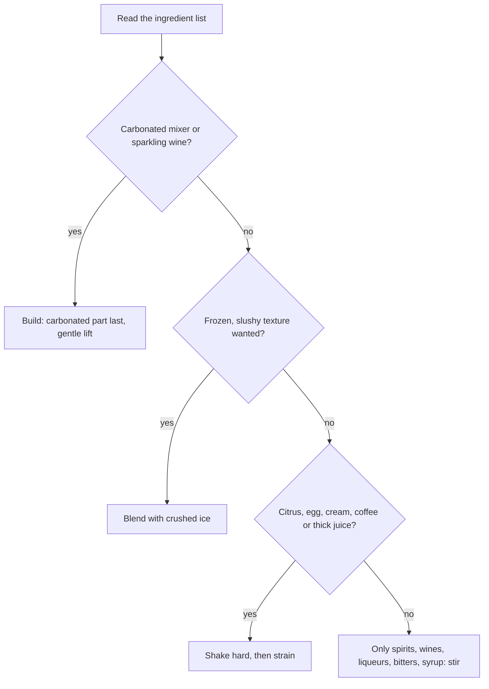

# 04.1 · Choosing the method: build, stir, shake or blend

Every cocktail recipe ends with a verb: build, stir, shake or blend. That verb is not decoration. It decides how cold the drink gets, how much water the ice adds, whether the drink is clear and silky or cloudy and frothy, and how long it takes you to make. This lesson gives you a simple rule for choosing the method from the ingredient list, shows what each method does in numbers, and explains when the IBA spec and common bar practice differ. In the hands-on part you sort twenty classic drinks by method and feel each method once with water and ice.

## Why it matters

A guest orders a Negroni and a colleague, in a hurry, shakes it. It arrives cloudy, with a layer of foam and tiny ice chips, and tastes thin. The guest sends it back. Another night a new bartender stirs a Margarita: it comes out warm, flat and sharp, because lime juice needs the hard mixing and extra water that only shaking gives. Neither bartender used a wrong ingredient or a wrong amount; they used the wrong method. Choosing the method correctly is the first decision you make on every cocktail ticket, and it costs nothing to get right.

## Core ideas

### What every method does

Every method that uses ice does four things at once, in different amounts:

- **Chills** the drink. Ice cools mostly by melting (lesson [01.6](../module-01/lesson-06.md)).
- **Dilutes** it: the melted ice becomes part of the drink. **Dilution** (דילול, *dilul*) is the water added, written as a percentage of the volume you started with (lesson [03.5](../module-03/lesson-05.md)).
- **Mixes** the ingredients so that thick syrups and juices are spread evenly.
- **Changes the texture.** **Aeration** means beating tiny air bubbles into a drink. Bubbles make a drink feel lighter and frothier and make it look cloudy.

| Method | What you do | Chill and dilution | Texture and look | Typical time |
|---|---|---|---|---|
| **Build** | Pour the ingredients straight into the serving glass over ice | Slow; keeps rising while the guest drinks | Keeps carbonation; clear | 10–20 s of work |
| **Stir** | Stir in a mixing glass with ice, then strain | Moderate | Silky, clear, no bubbles | 20–30 s (some bars 30–45 s) |
| **Shake** | Shake hard in a sealed shaker with ice, then strain | Fast and strong | Frothy, cloudy, light; foam if egg, coffee or pineapple | 10–15 s |
| **Blend** | Blend with crushed ice in an electric blender | Very strong; the ice becomes part of the drink | Thick, slushy, frozen | 15–30 s |

Three less common methods, covered later in this module, fill gaps between these: **swizzling** (spinning a stick in crushed ice in the glass), **throwing** (pouring the drink between two vessels from a height) and **muddling** (pressing fruit, herbs or sugar before building or shaking).

### The numbers behind the methods

Dave Arnold, a food scientist who measured cocktails in a lab, found that a hard shake chills and dilutes a drink to a near-steady state in about 15 seconds, and that stirring is slow, inefficient shaking: it can take over two minutes of stirring to match 15 seconds of shaking. That is why stirred drinks end up warmer and less diluted than shaken ones. Difford's Guide gives a similar figure for shaking: about 12 seconds brings the drink to roughly −5 to −8 °C, and longer adds little.

This course uses one educational model of dilution for all lessons and simulations, built on Arnold's measurements. The more alcohol a drink starts with, the colder it can get and the more ice melts. Rounded results:

| Example | Starting ABV | Method and time | Water added (model) |
|---|---|---|---|
| A sour (spirit, citrus, syrup) | about 25% | shake 12 s | about 63% of the starting volume |
| A spirit-forward drink (spirit, vermouth, bitters) | about 32% | stir 20 s / 30 s | about 37% / 44% |
| The same drink, thrown | about 33% | 4–5 throws, about 8–10 s | about 35–39% |
| A highball (spirit, mixer) on cubes | about 10% | build, 30 s / 5 min | about 3% / 14% |

So a 95 ml sour goes into the shaker and roughly 155 ml comes out, while a 90 ml stirred drink grows to about 125–130 ml. These are model numbers, not laws: your ice, tins and hands change them, and lesson 03.5 had you measure your own. The direction is what matters for choosing a method: **shaking adds the most water and air, stirring less water and no air, building the least water at first.**

> [!NOTE]
> The dilution figures come from this course's educational model (`dilution-lab` simulation), based on Dave Arnold's published measurements, checked 2026-10-17. Arnold himself rejects a single "ideal" dilution for all drinks. Methods in the IBA specs were checked on iba-world.com on 2026-10-17; IBA updates its list from time to time.

### The rule: look at the ingredients

You can choose the method for almost any drink by asking four questions in order.

1. **Carbonated?** Soda, tonic, ginger beer, cola or sparkling wine lose their bubbles if shaken (and can blow a shaker open). Build the drink and add the fizzy part last. Lesson [03.6](../module-03/lesson-06.md) explains why.
2. **Frozen?** If the drink should be a slush, blend it. The IBA Piña Colada, for example, is blended with ice and served in a large glass with straws.
3. **Citrus, egg, cream, coffee or thick juice?** These need hard mixing to combine, more dilution to soften their sharpness or richness, and aeration for a lively texture. Shake.
4. **Only clear spirits, wines, liqueurs, bitters and syrup?** Stir. The drink stays clear and silky, and the lower dilution keeps it rich. A shaken Martini is not "wrong" if a guest asks for it, but it is a different drink: cloudier, colder, thinner.

A useful shortcut used by many bartenders: **"If it's all booze, stir it; if it has juice, shake it"** (professional judgment). The four questions handle the cases the shortcut misses: fizz and frozen drinks.

### Muddled drinks

Fresh mint, lime pieces or sugar cubes must be pressed first to release flavour. That is **muddling** (lesson 04.5). After muddling you still choose a method by the same rules: a Mojito is muddled and then built with soda; a Caipirinha is muddled and built over cracked ice; a Mint Julep is muddled, then filled with cracked ice and stirred until the cup frosts.

### When the spec and the bar disagree

The IBA spec is the course default, but some drinks are made two ways in good bars:

- **Negroni:** the IBA spec builds it in an old fashioned glass with ice and stirs gently. Many bars stir it in a mixing glass and strain it onto fresh ice for more control of dilution. Both give a clear, silky drink.
- **Old Fashioned:** IBA muddles a sugar cube with bitters and water in the glass, then adds ice and whiskey. Many bars stir it in a mixing glass with syrup and strain it onto a large cube.
- **Bloody Mary:** IBA stirs it gently in a mixing glass. Many bars "roll" it between two tins (a gentle throw) to mix the thick tomato juice without making it foamy.

When a bar has its own house method, use it; when there is none, use the IBA spec. Never change the method silently because it is faster.

### What water can and cannot tell you

| You can practise with water | You need real ingredients to judge |
|---|---|
| Hand positions, grip, rhythm and timing | Whether the drink is balanced after dilution |
| Sealing and opening a shaker safely | The texture of shaken citrus versus stirred spirit |
| Consistency: the same weight gain on every rep | Foam quality from egg white, aquafaba or coffee |
| Straining without ice chips | How much aroma a twist or a throw adds |
| Building in the right order, keeping soda fizzy | Whether a stirred drink is "cold enough" by taste |

Water cannot get colder than 0 °C, but an alcoholic mix can, so plain water melts much less ice than a real drink: in the course model, water shaken for 12 seconds gains about 19%, against about 63% for a sour. Use water to train your hands and your consistency; use real ingredients (or the alcohol-free versions in Modules 5 and 6) to judge flavour. Tasting is always optional and small.

## Step by step

### Choose the method for any drink

1. Read the whole ingredient list before you pick up a tool.
2. Ask the four questions in order: carbonated? frozen? citrus, egg, cream, coffee or thick juice? only spirits, wines and syrups?
3. Check for fresh herbs, fruit pieces or a sugar cube: if there are any, muddle first, then apply the answer from step 2.
4. Check the house spec or the IBA spec. If it names a different method from yours, use the spec and note why it differs.
5. Pick the tools for that method before you start: serving glass, then mixing vessel, ice, strainer.

### The tools each method needs

| Method | Vessel | Ice | Strainer | Serving glass |
|---|---|---|---|---|
| Build | The serving glass | Fresh cubes, glass full | None | Highball, rocks or wine glass |
| Stir | Mixing glass or tin | Fresh cubes, about two-thirds full | Julep or Hawthorne | Chilled coupe or rocks glass on fresh ice |
| Shake | Boston tins (or cobbler) | Fresh cubes, large tin about two-thirds full | Hawthorne, plus fine strainer if served "up" | Chilled coupe, or rocks glass on fresh ice |
| Blend | Blender jug | Crushed ice | None | Large glass, straw |

"Up" means served without ice in a stemmed glass; "on the rocks" means served over ice.

## Hands-on

### What you need

- The cards: [labs/module-04/method-sort-cards.md](../../labs/module-04/method-sort-cards.md) and, for checking afterwards only, the solution file in the same folder.
- A shaker (or a jar with a tight lid), a mixing glass (or any tall glass), a bar spoon (or a long teaspoon), a strainer (or a tea strainer), a jigger, a highball glass.
- Ice cubes from your freezer, about 600 g, and cold water.
- A kitchen scale with 1 g steps, a phone stopwatch, a towel.
- Your practice log ([template](../../templates/practice-log.md)).
- Low-cost alternative: a clean jam jar with a lid works as a shaker; a large mug works as a mixing glass.

### Time

40 minutes: 15 for the cards, 15 for the three water runs, 10 to clean up and log.

### Steps

1. Fill in all 20 method sort cards without looking anything up. Write one reason per card.
2. Check your answers with the solution file and score yourself out of 40.
3. For each card you missed, write which of the four questions you skipped.
4. Water runs. For each run, measure 90 ml cold water into the vessel, weigh it with the vessel tared, and write the weight.
5. **Build:** fill a highball glass with ice, pour the 90 ml over it, lift once with the spoon, wait 30 seconds, strain the liquid off into a tared container and weigh.
6. **Stir:** fill the mixing glass two-thirds with ice, add the 90 ml, stir 20 seconds, strain and weigh.
7. **Shake:** fill the large tin two-thirds with ice, add the 90 ml, seal, shake hard 12 seconds, strain and weigh. (Lesson 04.4 teaches the full shake; for now hold both ends firmly with both hands.)
8. Work out the weight gain of each run as a percentage: (after − before) ÷ before × 100.
9. Log your card score, the three percentages and one sentence comparing them.

### What you should see

The shaken water gains the most weight, the stirred water less, and the built water the least after 30 seconds. The shaken water also looks cloudy with tiny bubbles for a minute; the stirred water is clear. The course model predicts about 2% for the build, about 16% for the 20-second stir and about 19% for the 12-second shake with plain water; you will usually measure a few points less, because some water stays on the ice. The gap between stir and shake is small with water and much bigger with a real cocktail, because alcohol lets the drink get colder than 0 °C. What matters here is the order and that you can see the difference in look and texture. On the cards, most beginners score 28–34 on a first try and lose points on the built Negroni and Old Fashioned and on the blended Piña Colada (professional judgment).

Sample result

Cards: 31/40. Missed: Negroni (chose stir; IBA builds it, but stir is an accepted alternative, so no points lost; noted anyway), Bloody Mary (chose shake; thick tomato juice is stirred or rolled), Mint Julep (chose shake; it is muddled and stirred with crushed ice). Water: build 90 → 92 g (+2%), stir 90 → 103 g (+14%), shake 90 → 105 g (+17%).

### What this practice cannot teach

Water shows you how much each method mixes and dilutes, but not how a real sour or a real Martini tastes when the method is right or wrong; that comparison comes with the alcohol-free and optional real versions in Modules 5 and 6.

### Completion checklist

- [ ] I completed all 20 cards before checking the solution, and scored them out of 40.
- [ ] For every miss I wrote which question I skipped.
- [ ] I ran the water build, stir and shake, weighing before and after each.
- [ ] My three weight gains are in my practice log, with the order shake > stir > build or a note on why not.

## Common mistakes

- **Shaking anything carbonated.** The pressure can push the tins apart and the soda goes flat. Fix: build, and add the fizzy part last.
- **Stirring citrus drinks.** They come out warm, under-diluted and sharp. Fix: if there is juice, shake.
- **Shaking clear spirit-forward drinks by habit.** They turn cloudy, thin and full of ice chips. Fix: stir unless the guest asks otherwise.
- **Choosing by the glass.** A coupe does not mean "shake" and a rocks glass does not mean "build". Fix: decide from the ingredients, then pick the glass from the spec.
- **Changing the method to save time.** Building a drink that should be stirred changes its dilution and texture. Fix: follow the spec; speed comes from preparation, not shortcuts.
- **Treating dilution as an error.** Water from ice is part of the recipe. Fix: plan it; never "save" a drink by using less ice.

## Key takeaways

- The method sets temperature, dilution, texture and clarity, so it is part of the recipe.
- Four questions in order: carbonated → build; frozen → blend; citrus, egg, cream, coffee or thick juice → shake; only spirits, wines and syrups → stir.
- Muddle first when there are fresh herbs, fruit pieces or sugar cubes, then choose the method as usual.
- In this course's model a shaken sour gains about 63% water in 12 s, a stirred spirit-forward drink about 37–44% in 20–30 s, and a highball on cubes only a few percent at first.
- Water trains your hands and consistency; balance, foam and aroma need real ingredients to judge.

## Sources

- [IBA — Official cocktail list](https://iba-world.com/cocktails/) (methods for the 20 drinks on the sort cards; accessed 2026-10-17)
- [Cooking Issues — Cocktail Science in General, Part 1 of 2](https://cookingissues.com/2010/09/02/cocktail-science-in-general-part-1-of-2/) (Dave Arnold: shaking reaches near-equilibrium in about 15 s; stirring can take over 2 minutes to match; accessed 2026-10-17)
- [Cooking Issues — Cocktail Science in General, Part 2 of 2](https://cookingissues.com/2010/09/08/cocktail-science-in-generalpart-2-of-2/) (no single ideal dilution; shaken versus stirred texture; accessed 2026-10-17)
- [Difford's Guide — Shaking cocktails: advanced tips, myths and lessons](https://www.diffordsguide.com/encyclopedia/591/cocktails/advanced-cocktail-shaking-tips-myths-and-lessons) (about 12 s of shaking reaches −5 to −8 °C; accessed 2026-10-17)
- [IBA — Piña Colada](https://iba-world.com/iba-cocktail/pina-colada/) (blended with ice in an electric blender; accessed 2026-10-17)
