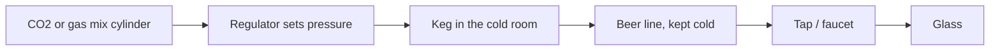

# 07.2 · Pouring beer: draught, bottle and can

Pouring beer looks like the easiest job behind a bar, and it is the one guests judge most often. A good pour has a firm, creamy head of about two to three centimetres, no tap marks on the glass, and arrives quickly. A bad pour is either a glass of foam you have to wait on, or a flat glass filled to the brim. This lesson teaches the standard pour from a tap, a bottle and a can, explains what the head does, and shows you how to tell your own mistakes from a problem in the draught system. You will train the movement with water, and you will learn exactly what water cannot show you.

## Why it matters

It is a Thursday night and eight people order the house draught at once. If each pour turns into a glass of foam, you wait, top up, wait again, and pour beer down the drain. If you pour flat to the brim, the beer looks tired and the guests notice the difference from the next table. Pouring well is speed, cost and quality in one movement.

## Core ideas

### Why a beer needs a head

The head (קצף, *ketzef*) is foam made by CO2 escaping as the beer is poured. The Brewers Association explains that a controlled release of CO2 lifts aroma out of the beer, makes the beer look right, and leaves a less gassy beer in the glass. Its manual recommends a collar of foam of about one inch (2.5 cm), and notes that foam is about 25% beer: filling the glass to the rim with liquid is over-pouring, not generosity. Some styles, such as German wheat beers and many Belgian ales, are traditionally served with a taller head (professional judgment; see the Cicerone glass list for wheat beers "with a mountain of foam").

### The draught system in one picture

A gas cylinder pushes beer from the keg (חבית, *chavit*) through a cold line to the tap (ברז, *berez*). Pressure, temperature and line length are set by the installer so the beer arrives with the right fizz; the Brewers Association calls this "balance" and gives a normal flow of about 2 oz (60 ml) per second. A bartender does not change these settings on shift. You do control the glass, the angle, the tap and the timing. Changing kegs and handling gas cylinders safely are taught in Module 8.

### Rules from the Brewers Association

- Open the tap **fully**. A half-open tap causes turbulence, extra foam and waste.
- Hold the handle at its base to control it.
- The tap nozzle must **never touch the glass** (it can chip the glass and carry dried beer into it) and **never dip into the beer** (bacteria grow on a wet nozzle).
- Use a beer-clean glass for every pour ([lesson 07.1](lesson-01.md)), at room temperature or chilled dry, never frozen.

### Bottle and can

The Cicerone Certification Program's home pouring guide gives the same idea for a bottle or can: tilt the glass, pour down the side, and a little past halfway stand the glass up and pour into the middle to build the head. Use two hands at first.

Two special cases (professional judgment):

- **Bottle-conditioned beer** (a beer that has had a second fermentation in the bottle and has a layer of yeast at the bottom, often Belgian-style ales): pour slowly in one go and leave the last centimetre with the yeast in the bottle, unless the guest asks for it.
- **German wheat beer (hefeweizen)**: the yeast is part of the style. Pour most of the bottle, then swirl the last bit to lift the yeast and add it to the glass.

Serve the bottle or can next to the glass if the guest wants to see the label or pour the rest themselves. Never let a guest drink from a glass with a chip; replace it.

### Foamy or flat: yours or the system's?

| Symptom | Causes a bartender controls | Causes in the system (tell the manager) |
|---|---|---|
| Too much foam | tap only half open; glass straight upright from the start; frozen or warm glass; dirty glass | beer too warm (cold room or line); pressure set too high; dirty lines; nearly empty keg |
| Flat, little or no head | glass held at an angle the whole time; dirty glass (film kills foam) | pressure too low; beer too cold; keg left disconnected |
| Sour or "off" taste | — | dirty lines; old keg |

This split is professional judgment, built on the Brewers Association's list of pouring rules and its chapters on temperature and line cleaning. The first beer after a long break may come out foamy because the beer in the tap has warmed; pour it off into a waste jug, not to a guest (professional judgment).

Hebrew you will hear: "פתח את הברז עד הסוף" (*ptach et haberez ad hasof*, "open the tap all the way"); a pint glass is often just "פיינט" (*paint*); "להחליף חבית" (*lehachlif chavit*, "change the keg").

> [!NOTE]
> Pouring rules, the one-inch head, foam at 25% beer and the 60 ml per second flow are from the Brewers Association Draught Beer Quality Manual (2017 edition PDF; the current free download is the 2019 edition). The bottle pour is from Cicerone's home guide (2020). Checked 2026-10-17. These are stable practice; your bar's own tap list, glass sizes and pour lines come first.

## Step by step

### Pouring a draught beer

1. Take a beer-clean glass. Check it for chips and film.
2. Hold the glass at about 45°, under the tap but not touching it, about 2–3 cm below the nozzle.
3. Open the tap fully in one movement, holding the handle at its base.
4. Let the beer run down the side of the glass.
5. When the glass is about half full, bring it upright gradually and pour into the middle so a head forms.
6. Close the tap quickly when the liquid is about 2–3 cm below the rim and the foam just reaches the rim.
7. Serve on a coaster with the logo or label facing the guest (professional judgment), holding the glass low, never by the rim.

### Pouring a bottle or can

1. Open the bottle or can away from the guest's face.
2. Tilt the glass and pour down the side.
3. A little past halfway, stand the glass up and pour into the middle to build the head.
4. Bottle-conditioned: stop before the yeast. Wheat beer: swirl the last part and add it.
5. Put the bottle or can beside the glass if there is beer left.

## Hands-on

A water pour drill that trains the angle, the switch to upright and the stop at a fill line, then one optional real pour to see foam.

> [!CAUTION]
> Work over a sink or tray, use glasses without chips, and stop if a glass cracks. Wipe up spilled water at once: wet floors are the most common cause of falls behind a bar.

### What you need

- A 330 ml glass and a 500 ml glass (or any two tall glasses), a kitchen scale (1 ml water ≈ 1 g), a phone stopwatch.
- A 1–1.5 litre water bottle or jug with a narrow spout (stands in for the tap) and a strip of tape or a marker.
- The scoresheet [`labs/module-07/pour-drill.csv`](../../labs/module-07/pour-drill.csv) and [`templates/practice-log.md`](../../templates/practice-log.md).
- Low-cost alternative: no scale? Mark the fill line with a measuring cup instead (pour 300 ml or 450 ml into the glass once, mark the level with tape) and judge by eye.

### Time

45 minutes.

### Steps

1. Set the "liquid line" on each glass: weigh 300 g of water into the 330 ml glass and 450 g into the 500 ml glass, and mark the level with tape. The space above the line stands for the head.
2. Empty and dry the glasses. Put the 330 ml glass on the scale and zero it.
3. Pour 10 times into the 330 ml glass with the draught method: 45° tilt, pour down the side, upright at halfway, stop at the line. Time each pour from first drop to stop. Write the weight and time in the CSV.
4. Repeat 10 times with the 500 ml glass.
5. In the CSV, calculate the error for each pour (weight minus target). Your target is ±10 g on every pour by the last five pours.
6. Film three pours from the side. Check: is the glass at 45° at the start? Is it upright by halfway? Does the spout ever touch the glass?
7. Optional, to see foam: pour one can of soda water (or, if you are 18+ and not driving, one small beer) into a glass held straight upright from the start, and one with the 45° method. Compare the foam. Soda shows the difference only a little; beer shows it clearly.

### What you should see

The first pours usually overshoot by 20–40 g because the stop comes late; by the last five most learners are within ±10 g. Times for a 500 ml pour are usually 8–12 seconds from a bottle; a real tap at about 60 ml per second is faster. Pours that stay tilted to the end look smooth in water; with beer they would come out with little head. With soda, the upright-from-the-start pour fizzes higher; with beer, it produces a glass of foam.

Example log, last five 500 ml pours

Targets 450 g. Pours: 457, 446, 452, 449, 455 g; errors +7, −4, +2, −1, +5 (all within ±10). Times 10.2, 9.8, 9.5, 9.6, 9.1 s. Film check: glass upright too late on the first pour (at about two-thirds); fixed by watching the halfway line.

### What this practice cannot teach

Water cannot reproduce beer foam or carbonation, and a bottle is not a tap: the real feel of a fully open faucet, a hot cold room, a foaming keg or a dirty line only comes on a real bar with real beer.

### Completion checklist

- [ ] I marked liquid lines on a 330 ml and a 500 ml glass.
- [ ] I completed 20 timed water pours and recorded weight and time.
- [ ] My last five pours on each glass were within ±10 g of the line.
- [ ] I filmed three pours and checked the angle, the switch to upright and that the spout never touched the glass.
- [ ] I logged the session in my practice log.

## Common mistakes

- **Opening the tap halfway.** The beer churns and foams. Fix: open fully, control the flow with the glass angle.
- **Dipping the nozzle into the beer to "fix" the head.** It spreads bacteria and is not allowed. Fix: tilt and re-pour, or pour a new glass.
- **Holding the glass tilted to the end.** Little head, more gas in the guest's stomach, less aroma. Fix: upright at halfway.
- **Pouring the yeast from every bottle.** It clouds clear styles. Fix: stop before the yeast unless it is a wheat beer or the guest wants it.
- **Blaming yourself for a system fault.** If every glass foams even with good technique, check temperature and tell the manager; do not keep pouring beer down the drain.

## Key takeaways

- Tilt to 45°, open the tap fully, go upright at halfway, stop at a head of about 2–3 cm.
- The tap never touches the glass and never dips into the beer.
- The head carries aroma and is about 25% beer; a brim-full glass is over-pouring.
- Bottles and cans use the same tilt-then-upright pour; leave or add yeast according to the style.
- Some foam problems are yours (angle, half-open tap, dirty or frozen glass), others belong to the system (temperature, pressure, lines).

## Sources

- [Brewers Association — Draught Beer Quality Manual](https://www.brewersassociation.org/educational-publications/draught-beer-quality-manual/) (publisher page; current free edition 2019; accessed 2026-10-17)
- [Brewers Association — Draught Beer Quality Manual, 2017 edition (PDF)](https://brewersguild.org.nz/wp-content/uploads/2024/04/2017-American-Brewers-Association-Guide-to-Draught-Beer-Quality.pdf) (45° pour, fully open faucet, one-inch head, foam about 25% beer, nozzle hygiene, flow 2 oz per second; accessed 2026-10-17)
- [Cicerone — Pouring the perfect pint of beer at home](https://www.cicerone.org/sites/default/files/resources/Perfect_Pour_at_Home.pdf) (tilt, pour down the side, upright a little past halfway; accessed 2026-10-17)
