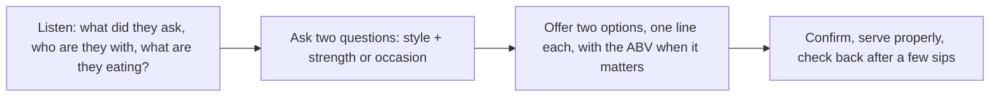

# 07.6 · Recommend a drink: customer role-play

This is the module's practical piece. Everything from Module 7, styles, temperatures, glasses, pouring, wine grapes, Israeli wine, opening bottles and alcohol-free options, comes together in one skill: listening to a guest and recommending something they will enjoy. You will learn a short routine that works for beer, wine, sparkling and zero-proof drinks, a table that turns vague guest words into styles, and the few food-and-wine rules that solve most pairing questions. Then you work through ten scripted guests on a sample drinks list, write your recommendations, and compare them with model answers and a rubric.

## Why it matters

"What do you recommend?" is the most common question a bartender hears, and it is a test. A good answer sells a drink the guest is happy with, builds trust, and brings them back. A lazy answer ("everything is good") or a pushy one (the most expensive bottle) loses that trust. Some of these questions are also safety questions in disguise: the pregnant guest who wants "something festive", the guest who has clearly had enough and asks for "your strongest beer".

## Core ideas

### The four-step routine

1. **Listen.** Note the words they use, the food on the table, whether they are driving or celebrating. Notice whether they seem intoxicated (Module 9).
2. **Ask two questions**, no more: one about style ("crisp or round?", "light or rich?", "bitter or not?") and one about strength or occasion ("something light, or a proper drink?", "with dinner or before?").
3. **Offer two options** from the list, each with one guest-language line. Two choices feel helpful; five feel like homework (professional judgment).
4. **Confirm and serve**: repeat the order, serve at the right temperature in the right glass (lessons 07.1–07.4), and check back after a few sips. If they do not like it, replace it gracefully (house policy).

### Translating guest words

| Guest says | Usually means | Beer | Wine | Zero-proof |
|---|---|---|---|---|
| "Light" | low body, maybe low alcohol | pale lager, wheat | Pinot Grigio, Sauvignon Blanc, Pinot Noir, dry rosé | 0.0 lager, spritz-style analogue |
| "Not bitter" | low hop bitterness, low tannin | lager, wheat, not IPA | whites, Pinot Noir, Merlot | fruity highball |
| "Dry" | not sweet (sometimes "not sour") | most lagers | ask "crisp or round?" | tonic-based highball |
| "Smooth" | soft, low tannin, low acidity | wheat beer, nitro stout | Merlot, oaked Chardonnay | — |
| "Strong" or "something with character" | more flavour or more alcohol (ask) | IPA, stout, strong ale in a small glass | Cabernet Sauvignon, Syrah | bitter aperitif-style analogue |
| "Refreshing" | cold, crisp, often fizzy | pilsner, wheat | Sauvignon Blanc, brut sparkling | citrus highball, NA sparkling |
| "Sweet" | some sugar | fruit beer, some ciders | off-dry Riesling, sweet sparkling (demi-sec) | most mocktails |

This table is professional judgment built on the styles in lessons 07.1 and 07.3. Always check the actual product on your list: a "light" lager can be 6%.

### Five food-and-wine rules

The WSET Level 2 course lists the food components that change how wine tastes: sweetness, umami, acidity, salt, flavour intensity, fat and chilli heat. The practical rules that follow from them (professional judgment, consistent with that list) are:

1. **Sweet food** makes wine taste drier and more bitter: dessert needs a wine at least as sweet as the dish.
2. **Umami** (mushrooms, aged cheese, tomato, soy) makes wine taste more bitter and tannic: choose a softer red or a white.
3. **Acid and salt in food** make wine taste softer and fruitier: high-acid wines work well with salty or tangy dishes.
4. **Fatty food** softens tannin and acidity: a big red with steak, a crisp white or sparkling with fried food.
5. **Chilli heat** makes alcohol burn more: off-dry, lower-alcohol whites or a cold beer work best.

Match **intensity** too: a light dish with a light drink, a rich dish with a fuller one. With beer the same logic applies: a crisp lager cuts through fried food; a stout stands up to grilled meat or chocolate (professional judgment).

### When a recommendation is a safety question

| Request | What you do |
|---|---|
| Pregnant guest wants "something festive" | 0.0% sparkling or a zero-proof drink in a flute; state any ABV ([lesson 07.5](lesson-05.md); Israeli Ministry of Health) |
| Guest who appears intoxicated asks for "your strongest" | do not serve a stronger drink; offer water, food or a zero-proof drink; involve the manager (Module 9) |
| Possible minor | ask for ID before any alcohol recommendation (Module 9) |
| Allergy (sulphites, gluten, nuts) | read labels and specs; never guess; say when you do not know (Module 9) |
| Kosher / mevushal request | show the certification; read "mevushal" on the label; bring a non-mevushal bottle sealed and ask ([lesson 07.3](lesson-03.md)) |

These carry more weight than any style choice. The course's final assessment treats them as safety-critical (lesson 11.1).

### Upselling honestly

Suggesting a better wine or a second round is part of the job when it fits the guest: "If you like this Sauvignon Blanc, the one from the Galilee is a little richer." It is never right with a guest who has had enough, with someone who said they are on a budget, or by inventing facts about a product (professional judgment; Module 10 covers responsible upselling).

> [!NOTE]
> The food components come from the WSET Level 2 Wines specification (April 2026); service order and checking back are from the CMS Europe Service Standards; beer styles and temperatures as in lesson 07.1; pregnancy advice from the Israeli Ministry of Health. All checked 2026-10-17. The translation table and the rules derived from the WSET list are professional judgment. The sample drinks list in the lab is fictional.

## Step by step

### One recommendation, start to finish

1. Greet and listen: "What are you in the mood for?"
2. Note food, company, occasion and any signs of intoxication.
3. Ask a style question and a strength or occasion question.
4. Check the list for two matches. Check ABV, kosher/mevushal and allergen notes if relevant.
5. Offer both in one sentence each, with the ABV for anything strong or anything alcohol-free.
6. Repeat the order back.
7. Serve: right temperature, right glass, bottle opened safely if needed.
8. Check back after two or three sips. Replace or adjust if the guest is unhappy.

### Writing a recommendation for the role-play sheet

1. Guest number and what they said.
2. Your two questions (and the scripted answers).
3. Option A and option B, each with style, serve (glass, temperature) and ABV if relevant.
4. The one line you would say to the guest.
5. Any safety point and how you handled it.

## Hands-on

The module's practical piece: a written role-play with ten scripted guests on a fictional bar's drinks list, compared with model answers and scored with a 20-point rubric.

### What you need

- The bar's drinks list [`labs/module-07/drinks-list.md`](../../labs/module-07/drinks-list.md) (fictional bar, real styles).
- The ten guests [`labs/module-07/guest-scripts.md`](../../labs/module-07/guest-scripts.md).
- The answer sheet and rubric [`labs/module-07/recommendation-sheet.md`](../../labs/module-07/recommendation-sheet.md).
- The model answers [`labs/module-07/recommendation-model-answers-solution.md`](../../labs/module-07/recommendation-model-answers-solution.md) — open only after you finish all ten.
- Optional: a friend or family member to play the guests, and your phone to record the conversation.
- Low-cost alternative: everything is on paper; no drinks are needed.

### Time

90 minutes: 10 to study the list, 50 for the ten guests (5 each), 30 to compare and score.

### Steps

1. Read the drinks list. Mark each beer and wine with "light / medium / full" and note which wines are kosher and mevushal.
2. For each guest, read only the opening line first. Write your two questions before you read the scripted answers.
3. Read the scripted answers and write your two options, your spoken line, the serve (glass, temperature, how opened) and any safety point.
4. Optional: act out three of the guests aloud with a partner reading the script, and record yourself. Listen for whether you asked two questions and named two options.
5. Open the model answers. Score each guest with the rubric: 1 point for a suitable recommendation, 1 point for the right questions, serve details and ABV or safety handling.
6. Note any safety-critical miss (guests 4, 9 and 10). A miss there means re-reading lessons 07.3 and 07.5 and redoing that guest, whatever your total.
7. Write a three-line summary in your practice log: your score, your best answer, and the guest type you will practise again.

### What you should see

Most learners score 14–17 of 20 on a first attempt (professional judgment). The common misses are offering only one option, forgetting to state the ABV of an alcohol-free product with a small number, recommending an IPA to a "not bitter" guest, and offering a stronger beer to the intoxicated guest because they asked politely. Your recommendations do not have to match the model answers exactly; any drink on the list that fits the guest's words and the rules earns the point.

### What this practice cannot teach

Written scripts cannot reproduce a loud bar, a guest who changes their mind, tone of voice and body language, or the pressure of five people waiting; only real service, ideally next to an experienced bartender, builds that.

### Completion checklist

- [ ] I wrote two questions and two options for all ten guests before reading the model answers.
- [ ] I scored myself honestly with the 20-point rubric.
- [ ] I handled guests 4, 9 and 10 (safety-critical) correctly, or redid them after re-reading the lessons.
- [ ] I acted out at least three guests aloud (optional but recommended).
- [ ] I logged my score and one area to practise in my practice log.

## Common mistakes

- **Offering one option or five.** One feels pushy; five overwhelm. Fix: two, each with one line.
- **Recommending what you like.** The guest's words matter, not your taste. Fix: repeat their words back and match them.
- **Skipping the ABV.** Guests who drive, are pregnant or avoid alcohol need the number. Fix: say it for strong and alcohol-free drinks.
- **Treating "strongest" as a style question.** With an intoxicated guest it is a safety question. Fix: do not serve stronger; offer water, food or zero-proof; tell the manager.
- **Guessing about kosher, mevushal or allergens.** Fix: read the label or ask; say "let me check".
- **Forgetting the serve.** A perfect choice at the wrong temperature or in the wrong glass disappoints. Fix: lessons 07.1 and 07.4.

## Key takeaways

- Listen, ask two questions, offer two options, confirm and check back.
- Translate guest words into styles: "light", "not bitter", "dry", "smooth", "strong" each point to specific beers and wines.
- Food changes wine: sweet food needs sweeter wine; umami and chilli need softer, lower-alcohol choices; salt, acid and fat are friendly.
- Some recommendations are safety questions; they come before style.
- Upsell only when it serves the guest.

## Sources

- [WSET — Level 2 Award in Wines specification, issue 21 (April 2026)](https://www.wsetglobal.com/media/19132/wset_l2wines_specification_en_april2026_issue21.pdf) (food components that affect wine and wine components affected by food; accessed 2026-10-17)
- [Court of Master Sommeliers Europe — Service Standards 24.1](https://courtofmastersommeliers.org/wp-content/uploads/2024/05/Service-Standards-24.1.pdf) (repeat the order, answer questions on style and pairing, service sequence; accessed 2026-10-17)
- [American Homebrewers Association — Proper beer serving temperatures](https://homebrewersassociation.org/how-to-brew/proper-beer-serving-temperatures/) (style temperatures used in the model answers; accessed 2026-10-17)
- [Israel Ministry of Health — Alcohol consumption during pregnancy](https://me.health.gov.il/en/parenting/family-planning/healthy-pregnancy-and-preventing-risks/risks-in-pregnancy/alcohol-and-pregnancy/) (avoid alcohol completely; guest 4; accessed 2026-10-17)
