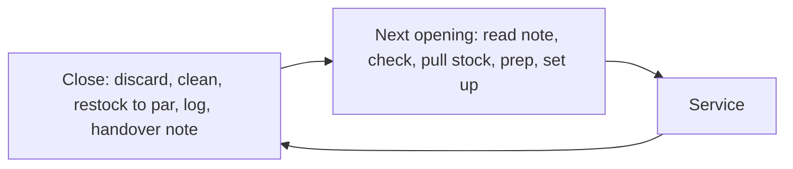

# 08.1 · Opening and closing the bar

In lesson 01.7 you set up and closed one home station against the clock. A real bar adds more to both ends of the shift: fridges and machines to check, stock to bring up from the storeroom, a team briefing before the doors open, and at the end of the night money, reports, restocking and a note for whoever opens tomorrow. This lesson shows the full opening and closing routine, the temperature checks that keep prep safe, and how opening and closing depend on each other. In the hands-on part you write your own opening and closing checklist and run a timed home opening and close with a temperature log and a handover note.

## Why it matters

You arrive at 17:00 to open for 18:00. The ice bin is half empty because nobody turned the ice machine back on, the bottle of lime juice in the fridge has no date on it, there is one bottle of the house gin on the rail and none in the storeroom, and the glasswasher was left full of dirty water. Every one of these problems was created at last night's close, and every one of them now eats into your hour. Bars that run well treat closing as the first half of tomorrow's opening: what the closer leaves is exactly what the opener finds. A new bartender who opens and closes completely, in order, and writes down what is missing is trusted with shifts quickly.

## Core ideas

### Opening and closing are one loop

The **opening** (פתיחה, *ptiha*) gets the bar from locked and empty to ready for the first guest. The **close** (סגירה, *sgira*) gets it from the last guest back to clean, safe and ready for the next opening. Both run from a written **checklist** that the person doing it ticks, times and signs with initials. A checklist is not an insult to your memory: it is how a bar makes sure the job is done the same way whoever is on shift.

### Who does what

Titles were introduced in [lesson 01.1](../module-01/lesson-01.md). In most bars the work is split roughly like this (professional judgment; every venue sets its own):

| Task | Usually done by |
|---|---|
| Unlock, alarm, walk-through, fridge and freezer temperatures | Opening bartender or shift manager |
| Stock pull from the storeroom to par, ice, glass, empties out | Barback |
| Juice, syrups, garnish (mise en place) | Bartenders, sometimes barback |
| Till float, POS check, reservations and events | Shift manager |
| Briefing: specials, 86 list, allergens, roles for the night | Shift manager or head bartender |
| Cash-up and end-of-day POS report | Shift manager |
| Station breakdown, cleaning, restock, handover note | Each bartender for their station |

Two words you will meet everywhere: **par** is the amount of an item the bar wants on hand at the start of a shift (lesson 08.4 shows how it is set), and the **86 list** is the list of items that are finished or unavailable tonight (lesson 08.7).

### Temperatures: the first check of the day

Juice, cut fruit, dairy, egg white and many syrups are kept in the fridge so that bacteria grow slowly. The check is simple and is the first thing you do, before you use anything from the fridge:

- **Fridges** should read between 0 and 4 °C. FOODSAFE, the British Columbia food-safety training programme, tells staff to check both the built-in and a separate thermometer and to act if a cooler is above 4 °C. The U.S. CDC gives 40 °F (about 4.4 °C) as the limit for keeping cut fruit; U.S. food codes use 41 °F (5 °C).
- **Freezers** should read −18 °C or colder (FOODSAFE).
- **Cut fruit** left out must go back into the fridge within 2 hours, or within 1 hour above 32 °C (90 °F), according to the CDC.

Write each reading in a **temperature log**: date, time, unit, reading, initials and action taken. If a fridge reads 8 °C at opening, do not quietly turn the dial: tell the shift manager, move the prep to a working fridge, and let them decide what has to be thrown away. Israeli Ministry of Health requirements for food businesses are covered in Module 9; the numbers here are the international guidance this course uses as a working standard.

### Machines that need to be started (and stopped)

A bar has machines that do not run themselves. At opening: the **ice machine** has made ice overnight and its bin is full, or you know why not; the **glasswasher** (מדיח, *mediach*) is filled, heated and its chemicals connected; the **soda gun** gives clean, cold, fizzy soda; the **POS** (point of sale, the till system) is on and showing tonight's menu; and in a bar with draught beer, the taps are pouring cleanly (Module 7 covers pouring). Lesson 08.6 explains each machine and its safety rules. At close, each machine is cleaned or switched off the way its maker says. Coca-Cola's bar gun guide, for example, lists a **daily** cleaning of the gun's nozzles, holster and the ice scoop and holder.

### Stock pull and restock

Bottles on the rail run out during service; backups wait in the **storeroom** (מחסן, *machsan*). At opening, the barback brings each item up to par for the station, oldest bottles first (FIFO, "first in, first out", from lesson 01.7). At close, you count what is low and either restock it or write it on the order list. A bar that restocks at close opens faster and never discovers at 22:00 that the last bottle of tequila was used yesterday.

### The briefing

A five-minute **briefing** (תדריך, *tadrich*) before the doors open tells everyone the same facts: tonight's bookings and events, specials, what is 86'd, any new allergen information (for example a new syrup that contains nuts), and who works which station. Write the key points on a small board or in the shift notes so latecomers see them.

### Closing: last orders to locked door

Closing starts before the last guest leaves. Last orders follow the venue's licence and opening hours (Module 9 covers Israeli rules on hours and sale). Then: stop making new prep; close every open tab and ticket on the POS; break down stations; store or discard every perishable with a label; empty, clean and dry the ice well; clean the glasswasher and soda gun; wipe and cap bottles, and cover or wash speed pourers so fruit flies are not drawn to sugar overnight; restock to par; take out bins and empties; check the floor for glass; fill in the temperature log and the handover note; lock up.

### The handover note

A **handover** (חפיפה, *chafifa*) note is three to six lines for the next opener: what ran out or is low, what was ordered, what broke or behaved strangely, what prep is in the fridge and when it was made, anything a guest or supplier needs tomorrow. "Gin: 1 bottle left, ordered 6 for Tuesday. Glasswasher drains slowly, told Dana. Lime juice discarded, 1 L 1:1 syrup made 21:00 Monday." The opener reads it before anything else.

> [!NOTE]
> Temperatures are from FOODSAFE (BC) and the CDC, checked 2026-10-17. The U.S. FDA released a new edition of its model Food Code on 17 September 2026; venues follow the rules of their own country and local authority, and Israeli requirements are in Module 9. Role splits and closing order are professional judgment and vary by bar.

## Step by step

### A bar opening

1. Unlock, switch off the alarm, switch on lights. Walk the bar, storeroom and toilets for anything unsafe: broken glass, leaks, a wet floor.
2. Wash your hands. Read the handover note and the 86 list from last night.
3. Check and log every fridge and freezer temperature. Report anything outside 0–4 °C (fridge) or warmer than −18 °C (freezer).
4. Check the ice machine bin; fill ice wells with the scoop, never with a glass.
5. Start the glasswasher (fill, heat, check chemicals) and check the soda gun.
6. Switch on the POS and check that tonight's menu and prices are loaded.
7. Pull stock to par from the storeroom, oldest first; take empties and cardboard out.
8. Make the prep list's juice, syrups and garnish (lesson 08.2); label everything with name, date, time and initials.
9. Set up each station as in [lesson 01.7](../module-01/lesson-07.md), including the five-pour calibration check.
10. Briefing. Then open the doors.

### A bar close

1. Last orders at the time the venue sets; stop new prep.
2. Close all tabs and tickets; the shift manager prints the end-of-day report and cashes up.
3. Discard juice and cut garnish you will not keep; cover, label and refrigerate what you keep (lesson 08.2 says which).
4. Empty, clean and dry the ice wells; clean tools, tins and boards.
5. Clean the soda gun nozzles and holster and the ice scoop and holder; clean and drain the glasswasher as its maker says.
6. Wipe and cap bottles; cover or wash speed pourers.
7. Count what is low; restock to par or write it on the order list.
8. Bins, empties and floor; check for broken glass.
9. Log fridge temperatures; write the handover note.
10. Switch off what should be off; lock up; set the alarm.

## Hands-on

### What you need

- Your home station from [lesson 01.2](../module-01/lesson-02.md) and the [station checklist](../../templates/station-checklist.md).
- The worksheet [labs/module-08/opening-closing-worksheet.md](../../labs/module-08/opening-closing-worksheet.md).
- A fridge thermometer (a cheap dial or digital one, about 20–40 ILS in kitchen shops; professional judgment) or your fridge's own display if it has one.
- Two lemons or limes, sugar, water, labels, a marker, a phone timer and your [practice log](../../templates/practice-log.md).
- Low-cost alternative: without a thermometer, practise the logging with the fridge display or write "no reading" and plan to buy one; never guess a number.

### Time

60 minutes: 20 to write the checklist, 20 for the timed opening, 15 for the timed close, 5 for the handover note and log.

### Steps

1. **Write the checklist.** On the worksheet, adapt the bar opening and close above to your home station: which steps apply, which become a home equivalent (your fridge, your "storeroom" cupboard), and who would do each step in a real bar.
2. The evening before, put the thermometer in the middle shelf of the fridge so it settles.
3. **Timed opening.** Start the timer. Read your handover note (if this is your first run, write one from yesterday in two lines). Log the fridge reading. "Pull stock": bring every bottle you practise with from the cupboard to your rail, oldest first. Make 100 ml of 1:1 syrup and juice one lemon; label both. Set up the station and do the five-pour calibration check. Write a three-line briefing for an imaginary shift. Stop the timer.
4. **Timed close.** Next day or after a practice session, start the timer. Discard or store prep correctly, empty and dry the ice bowl, wash and dry tools, wipe and cap bottles, put back stock and note anything low, log the fridge reading, write the handover note. Stop the timer.
5. Record both times, every missed or out-of-order step and the fridge readings on the worksheet and in your practice log.

### What you should see

A home opening with prep usually takes 12–20 minutes the first time and a close 8–12 minutes (professional judgment). Target for the second run: opening ≤ 15:00 and close ≤ 12:00 with no missed checklist item. Your fridge should read 0–4 °C; readings of 5–6 °C are common in a home fridge that is opened often or set too warm, and the fix is the dial setting and less door-opening, not a new fridge. If you missed steps, they were most likely the temperature log, labelling and the handover note: the steps that feel like paperwork are the ones that protect the next shift.

Example handover note and times

"Mon 21:40. Fridge 3 °C at open, 4 °C at close. Lemon juice discarded. 1:1 syrup 100 ml made Mon 17:20, in fridge door. Low: soda (2 bottles), lemons (1). Buy before Wednesday's session. Jigger 30 ml side reads a little high; check on the scale." Opening 16:40 (first run), 13:10 (second); close 11:30, 9:50.

### What this practice cannot teach

At home you have one fridge, no team and no cash; in a bar you will learn the venue's own checklist, the alarm code, the till and who signs what, and opening as part of a team teaches the timing in a way no home run can.

### Completion checklist

- [ ] I wrote an opening and closing checklist for my station with a real-bar owner for each step.
- [ ] I logged at least two fridge readings with date, time and initials.
- [ ] I ran a timed opening and a timed close and recorded the times and missed steps.
- [ ] I wrote a handover note that someone else could act on.

## Common mistakes

- **Treating close as "go home fast".** The next opener pays for every skipped step. Fix: close against the checklist and restock to par before you leave.
- **Reading the fridge and not acting.** A logged 9 °C with no action is worse than no log. Fix: report it at once and move the prep.
- **Opening without reading the handover note.** You repeat yesterday's problem. Fix: the note is step 2, before anything else.
- **Using prep with no label.** Nobody knows its age. Fix: if it has no name, date and time, it goes in the bin.
- **Leaving the soda gun and ice scoop until "the weekly clean".** Sugar and slime build up in a day. Fix: clean nozzles, holster, scoop and holder at every close.

## Key takeaways

- Opening and closing are one loop: what the close leaves is what the opening finds.
- Check and log temperatures first: fridges 0–4 °C, freezers −18 °C or colder; act on a bad reading.
- Pull stock to par oldest first; restock or write the order at close.
- Brief the team before the doors open: bookings, specials, 86 list, allergens, roles.
- End every shift with a short handover note the next person can act on.

## Sources

- [FOODSAFE (British Columbia) — Receiving and Storage Guidelines](https://www.foodsafe.ca/docs/Receiving_&_Storage_Guidelines.pdf) (coolers 0–4 °C with built-in and portable thermometers; freezers below −18 °C; FIFO; label with name and date; accessed 2026-10-17)
- [CDC — Salmonella infections linked to cut fruit, advice to consumers (2019, archived)](https://archive.cdc.gov/www_cdc_gov/salmonella/javiana-12-19/index.html) (refrigerate cut fruit within 2 hours, within 1 hour above 90 °F; keep at 40 °F or below; accessed 2026-10-17)
- [The Coca-Cola Company — Bar gun cleaning and sanitizing guide](https://www.cokesolutions.com/content/dam/cokesolutions/us/documents/foodservice-quality/foodservice-quality-BarGunCleaningandSanitizingGuide.pdf) (daily nozzle, holster and sheathing clean; clean ice scoop and holder daily; accessed 2026-10-17)
- [U.S. FDA — FDA releases 2026 Food Code](https://www.fda.gov/food/hfp-constituent-updates/fda-releases-2026-food-code) (2026 edition released 17 September 2026; model code adopted by jurisdictions; accessed 2026-10-17)
