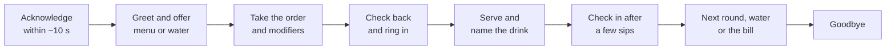

# 09.1 · Greeting guests, taking orders and recommending

A guest decides within the first minute whether a bar feels welcoming, and most of that minute is about you: whether you noticed them, how you greeted them, and whether the drink that arrives is the one they asked for. This lesson turns guest service into a short, repeatable routine: acknowledge, greet, take the order, check it back, recommend when asked, check in, and close the visit. It builds on the check-back from lesson 08.7 and the recommendation routine from lesson 07.6, and adds the Hebrew you will need on an Israeli bar. In the hands-on part you drill greetings and take ten recorded orders, scoring yourself on accuracy.

## Why it matters

Three people arrive at a full bar on a Thursday night. You are in the middle of four Mojitos. If you ignore them, they wait, feel invisible and may leave. If you look up, smile and say "Hi, I'll be with you in one minute", they wait happily for the same minute. Ten minutes later one of them orders "a gin and tonic, but with the pink gin, and slimline tonic, no ice". Miss one of those three details and the drink comes back. The trial-shift manager watches both moments: whether every guest is acknowledged, and whether every order arrives right the first time (professional judgment).

## Core ideas

### The guest journey at the bar

The targets (about 10 seconds to acknowledge, about a minute to greet) are this course's working standard, not a rule from any authority (professional judgment). What matters is that nobody stands at your bar wondering whether you have seen them.

### Acknowledge first, serve second

**Acknowledging** means a signal that you have seen someone: eye contact, a nod, a raised hand, "With you in a minute." It costs one second and does not interrupt the drink in your hands. **Greeting** is the start of the conversation when you are free: "Good evening, what can I get you?" In Hebrew: ערב טוב (*erev tov*, good evening), מה אפשר להביא לך? (*ma efshar lehavi lecha* to a man, *lach* to a woman, "what can I bring you?"). Many Israeli bars use a relaxed first-name style and the informal "you"; follow the house tone (professional judgment).

Serve in **arrival order**. When two groups arrive together and you are unsure, ask: "Who was first?" Guests notice when someone who came later is served first, and it starts arguments.

### Reading the guest in the first minute

While greeting, notice four things, quietly:

- **Age:** does anyone look under about 25–30? Check ID before you serve any alcohol (lesson 09.5 gives the law and the method).
- **State:** are they already intoxicated? Slurred speech, swaying or loud, clumsy behaviour change what you can serve (lesson 09.4).
- **Occasion and pace:** a quick drink before a film, a celebration, a date, a business meeting.
- **Needs:** a menu, water, food, a seat, help with the language.

This is not judging people. It is the information you need to serve them well and legally.

### Taking the order

An order has five parts. Say them back in this order:

| Part | Example |
|---|---|
| Number | two |
| Drink | Negronis |
| Modifier | one on the rocks, one up |
| Special need | one with no orange (allergy or preference: ask which) |
| Who or where | for you and your friend, on your tab |

A **modifier** is any change to the standard drink: double, no ice, up, extra lime, less sweet, alcohol-free, a different spirit. If a guest names a brand ("Tanqueray and tonic"), use that brand or say at once that you do not have it and offer the closest one before you pour. Never pour a different brand silently (professional judgment).

### Checking back with a guest

The check-back from [lesson 08.7](../module-08/lesson-07.md) works with guests too: repeat the order, wait for "yes", then make it. With a guest it should sound like hospitality, not a test: "So that's two Negronis, one up, one on the rocks, no orange in either. Perfect." If anything is unclear or contradictory, clarify before you pour ([lesson 09.2](lesson-02.md)). If the guest mentions an allergy, stop and follow [lesson 09.3](lesson-03.md); never treat it as a taste preference.

### Recommending

When a guest asks "What do you recommend?", use the four-step routine from [lesson 07.6](../module-07/lesson-06.md): listen, ask two questions (style, then strength or occasion), offer two options in one line each, and confirm. For cocktails, the two questions are often:

1. **Flavour direction:** "Fresh and citrusy, or rich and spirit-forward?" (sours and highballs versus stirred drinks, [lesson 06.1](../module-06/lesson-01.md)).
2. **Strength or length:** "A short, strong drink or something long and light?"

Then offer two drinks you can make well, with one honest line each: "A Paloma, tequila with grapefruit soda, long and refreshing; or a Margarita, shorter and sharper." Always include an alcohol-free option when the guest hesitates or mentions driving, and never push a stronger or more expensive drink on someone who has had enough (lesson 09.4).

### Serving and checking in

Put the drink down in front of the right person, name it ("Your Negroni, up"), and place a napkin or coaster. Check in after two or three sips, not after the first: "How's the Negroni?" If something is wrong, fix it ([lesson 09.2](lesson-02.md)). Keep an eye on empty glasses, but offer the next round in a relaxed way, never by refilling without asking.

### Tabs, bills and goodbyes

A **tab** (open bill) collects the guest's orders until they pay. Ring every drink in as soon as you take the order ([lesson 08.6](../module-08/lesson-06.md)); never "remember it for later". When the guest asks for the bill, החשבון (*hacheshbon*, the bill), bring it promptly, read it with them if they ask, and process payment in front of them. Tips, טיפ (*tip*), follow the house policy. Say goodbye to everyone who leaves, even when you are busy: "Thanks, have a great night." It is the last thing they remember.

> [!NOTE]
> The guest journey, target times and Hebrew phrases are professional judgment (common Israeli bar usage as of 2026-10-18). The check-back method is from health-care team training (AHA, TeamSTEPPS); the order of service and checking back after the first sips follow the Court of Master Sommeliers Europe Service Standards. House rules on tone, tabs and tips vary.

## Step by step

### Greet and take an order

1. Look up and acknowledge the guest within about 10 seconds, even mid-drink.
2. When free, greet: "Good evening, what can I get you?" Offer a menu or water.
3. Notice age, state, occasion and needs; check ID if needed (lesson 09.5).
4. Listen to the whole order without interrupting.
5. Check back: number, drink, modifier, special need, who or where.
6. Ring it in at once.
7. Make it, serve it to the right person and name it.
8. Check in after two or three sips.

### Answer "What do you recommend?"

1. Ask: fresh and citrusy, or rich and spirit-forward?
2. Ask: short and strong, or long and light?
3. Offer two drinks you make well, one line each, plus an alcohol-free option if relevant.
4. Confirm the choice and check it back.

### Close the visit

1. Offer water, the next round or the bill, depending on the guest.
2. Bring the bill promptly; check it with the guest if asked.
3. Take payment in front of them; close the tab on the POS.
4. Say goodbye; clear and wipe the space for the next guest.

## Hands-on

### What you need

- The drill sheet [labs/module-09/order-taking-drill.md](../../labs/module-09/order-taking-drill.md): 6 greeting situations and 10 guest orders with modifiers.
- A partner to play the guest, or a phone to record the orders yourself.
- Paper and pen (or a notes app), a timer, music at party volume, and your [practice log](../../templates/practice-log.md).
- Low-cost alternative: if you practise alone, record the ten orders in your own voice, wait a few hours, then play them back in random order with music on.

### Time

40 minutes: 10 for greetings, 20 for the ten orders, 10 to score and log.

### Steps

1. **Greetings.** Your partner reads the six greeting situations one by one (for example "you are shaking; two guests sit down at the far end"). For each, act it out: the acknowledgement, then the greeting when free, in English and in Hebrew. Time how long you take to acknowledge; aim for under 10 seconds from the moment the situation is read.
2. **Orders.** With music on, your partner reads each of the ten orders once, at normal speed, standing a couple of metres away. For each: check it back in the five-part order, wait for "yes" or a correction, then write it as you would ring it in.
3. **One recommendation.** Orders 9 and 10 are "What do you recommend?" requests. Ask your two questions; your partner answers from the card; offer two options and an alcohol-free one where the card calls for it.
4. **Score.** An order is correct only if number, drink, every modifier, special need and destination are right after the check-back. Count separately how many errors your check-back caught.
5. Compare with the answers at the bottom of the drill sheet and log your score and acknowledgement times.

### What you should see

Most learners catch one or two missed modifiers in the check-back, especially in orders with three details (professional judgment). The target is 10 of 10 correct after check-back and every acknowledgement under 10 seconds. If you often get the drink right but lose the modifier, say the modifier back first. If you blank on the Hebrew greeting, practise the two phrases until they are automatic: they matter more in the first minute than any cocktail knowledge.

Model greeting for situation 1

While shaking, make eye contact and nod: "Hi! One minute." When the drinks are served: "Thanks for waiting. Good evening, what can I get you?" / "ערב טוב, מה אפשר להביא לכם?" (*erev tov, ma efshar lehavi lachem*, to a group).

### What this practice cannot teach

A kitchen with music is not a bar three deep with guests waving cards; the drill builds the habits (look up, check back, ring in) so that they are already automatic when the real crowd arrives, and only real shifts teach you to read faces in a dim, noisy room.

### Completion checklist

- [ ] I acknowledged every greeting situation within about 10 seconds and greeted in English and Hebrew.
- [ ] I took ten orders with music on and checked each back in the five-part order.
- [ ] I scored my orders after check-back and counted the errors the check-back caught.
- [ ] I answered two "What do you recommend?" requests with two questions and two options.
- [ ] I logged my results in my practice log.

## Common mistakes

- **Head down until you are free.** Waiting guests feel ignored. Fix: acknowledge every new guest within seconds with a look, a nod or "one minute".
- **Losing the modifier.** The drink is right, the "no ice" is not. Fix: check back every order and say the modifiers clearly.
- **Silent brand swaps.** The guest asked for one gin and got another. Fix: say what you have before you pour.
- **Recommending your favourite, not theirs.** Fix: ask two questions first, then offer two options that match the answers.
- **Forgetting to ring in.** The drink is served but never billed, or billed to the wrong tab. Fix: ring in immediately after the check-back.

## Key takeaways

- Acknowledge every guest within seconds, greet when free, and serve in arrival order.
- In the first minute, notice age, state, occasion and needs: they decide what you may and should serve.
- Take orders in five parts (number, drink, modifier, special need, who or where) and check them back before pouring.
- Recommend with two questions and two options, always including an alcohol-free choice when it fits.
- Check in after a few sips, ring in every drink at once, and say goodbye to every guest.

## Sources

- [American Hospital Association — Closed-loop communication](https://www.aha.org/center/project-firstline/teamstepps-video-toolkit/closed-loop-communication) (sender, repeat-back, verification; adapted here to guest orders; accessed 2026-10-18)
- [Court of Master Sommeliers Europe — Service Standards (24.1, PDF)](https://courtofmastersommeliers.org/wp-content/uploads/2024/05/Service-Standards-24.1.pdf) (order of service and checking back with guests; as used in lesson 07.6; accessed 2026-10-18)
